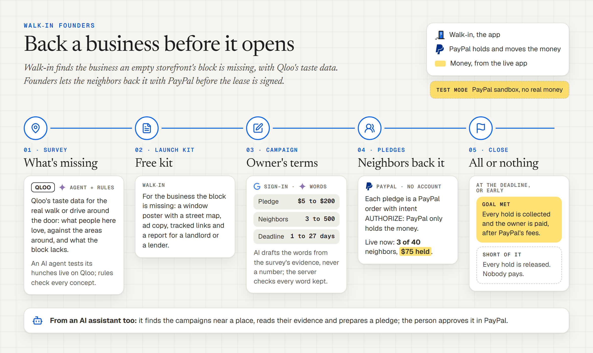
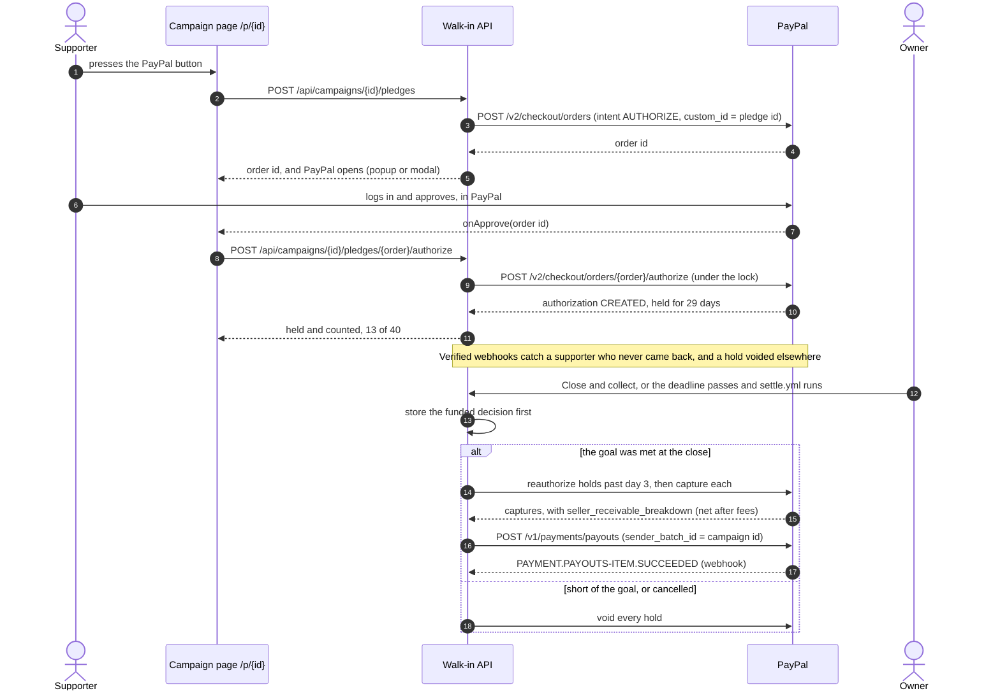

<picture>
  <source media="(prefers-color-scheme: dark)" srcset="docs/brand/banner-dark.svg">
  
</picture>

# Walk-in Founders

**Neighbors back a business idea before it opens. Walk-in surveys a storefront with Qloo's taste data and builds a free launch kit. Founders turns that kit, or the owner's own business description, into a campaign: the owner sets the money terms, AI helps draft the invitation, and each neighbor pledges with PayPal. PayPal only holds the money. If enough neighbors join by the deadline, the holds are collected and the owner is paid after fees; if not, the holds are released and nobody pays.**

Built for the [PayPal AI Hackathon](https://paypalaihackathon.devpost.com), which judges five criteria equally ([below](#judging-criteria)). This edition runs on PayPal's sandbox: no real money moves.

## Try it

- **Live:** https://walkin-app.pages.dev. [Founders](https://walkin-app.pages.dev/founders) lists the open campaigns; [the examples](https://walkin-app.pages.dev/examples) are six surveyed US storefronts, each with a ready launch kit. A campaign's page is `/p/{id}`, a launch kit's `/k/{token}`.
- **Demo payments.** Payment actions and money/status views say "Demo payments — no real money." Approving a pledge still takes a PayPal sandbox personal account, not a real one: judges find three in the submission's testing instructions, and [the testing guide](docs/founders/TESTING.md#before-you-start) shows how to make your own.
- **A free server.** The backend sleeps when idle and takes about 40 seconds to wake. Meanwhile the page says so, and the Cloudflare front door still serves the examples' pages it keeps.
- **From an AI assistant:** connect Walk-in's MCP server ([below](#agentic-commerce-a-person-approves-every-pledge)) and ask what is opening near you.

### The unified release

- **Your own business:** [start without a survey or kit](https://walkin-app.pages.dev/founders/start), using the same pledge rules and payment engine. These campaigns identify the description as the owner's words, not Qloo-verified evidence.
- **One customized poster:** a business-specific motif, palette, optional permitted logo and actual participation perks. The kit report and its A4/Letter PDF include the same device-local design on a dedicated poster page, with the public QR destination and full payment terms.
- **Private receipts:** supporters can follow a pledge or withdraw while the campaign is open, on the web or through their assistant with explicit consent. Receipt links are private cancellation capabilities, never public poster QR destinations.

### Two minutes for judges

1. Open [the examples](https://walkin-app.pages.dev/examples), pick a storefront (Milwaukee Avenue, Logan Square, Chicago, for one) and open its **Launch kit**. Choose the **Founders** tab.
2. **Sign in with Google.** Set the terms: the pledge, the neighbors needed (3 is the smallest goal), a deadline and a PayPal email for the money. Press **Draft with AI**.
3. Change the title to `The best place on the block` and press **Publish the campaign**. The server refuses it and says why: *The title says "best", which nothing measured proves.* Put a title of your own back and publish.
4. Open the campaign's link in a private window, as a neighbor would. Press the PayPal button, log in as the sandbox buyer and approve. The page says "Your pledge is held", and the count and the money PayPal holds go up.
5. Press **Withdraw my pledge**: PayPal releases the hold. Back in your own window, the owner's panel counts the pledges by status, and **Cancel and release every hold** ends the campaign with nobody charged.

Collecting needs the goal met by different PayPal accounts. That path, with three sandbox buyers, and the AI-assistant path are in [docs/founders/TESTING.md](docs/founders/TESTING.md).

## Judging criteria

| Criterion | Evidence |
|---|---|
| **Technological implementation** | • PayPal end to end: Orders v2 (intent `AUTHORIZE`, then authorize), Payments v2 (reauthorize, capture, void), Payouts v1, Webhooks v1 verified on the raw body, and the JS SDK v6 button ([app/payments/paypal.py](app/payments/paypal.py), [PayPalPledge.tsx](frontend/src/components/founders/PayPalPledge.tsx), [every call](#paypal-integration)).<br>• Money that cannot move twice: a `PayPal-Request-Id` that stays the same for the same operation on the same resource; the funded decision stored before the first capture; a payout recorded before PayPal is asked and keyed by its `sender_batch_id` ([app/settlement.py](app/settlement.py)).<br>• One process-local lock orders holds, withdrawals, closes, cancels and settlement passes; races between requests are tested by holding up PayPal's answer while a second request comes in ([the races](#races-and-the-one-lock)).<br>• Backend and frontend tests run on every push, with type checks and linters; see [CI](.github/workflows/ci.yml) for current results. |
| **Design** | • One path from evidence to money: the launch kit's Founders tab, the owner's terms, an AI draft to edit, then a campaign page whose count and terms sit beside PayPal's button ([CampaignForm.tsx](frontend/src/components/founders/CampaignForm.tsx), [CampaignPage.tsx](frontend/src/pages/CampaignPage.tsx)).<br>• The terms in plain words wherever money appears, from the campaign's own numbers: "PayPal holds $25. You are charged only if 40 neighbors join by Nov 30; otherwise the hold is released." With them, "Demo payments — no real money." ([lib/founders.ts](frontend/src/lib/founders.ts)).<br>• The customized poster leads with the actual participation perks, preserves the payment terms and frames its public QR outside the quiet zone. The report/PDF includes that same design ([ReportPoster.tsx](frontend/src/components/kit/ReportPoster.tsx)).<br>• Screen readers hear the progress ("12 of 40 neighbors") and each change in the count; withdrawing, closing and cancelling each ask first and say what happens to the money ([ProgressBar.tsx](frontend/src/components/founders/ProgressBar.tsx)). |
| **Potential impact** | • Made for empty storefronts, about 11% of all storefronts in New York City ([NYC Comptroller, June 2026](https://comptroller.nyc.gov/reports/whos-minding-the-storefronts)): before signing a lease, an owner learns whether enough neighbors will pay, and starts with their money.<br>• If the goal is missed, no pledge is captured. Supporters need no Walk-in account.<br>• Kit-backed campaigns carry Qloo's neighborhood evidence; owner-described campaigns clearly say they are not survey-verified ([the kit](#where-the-kit-comes-from)).<br>• An AI assistant can find campaigns near someone and prepare a pledge for them to approve ([mcp_server/README.md](mcp_server/README.md)). |
| **Innovation/Idea** | • A pre-sale for a storefront, decided by its neighbors: all-or-nothing pledges that PayPal holds and that are captured or voided at the close, not donations.<br>• AI writes the words, never the numbers: the owner sets the terms, the model drafts the title, pitch and perks from the survey's evidence, and the server checks the model's words and the owner's edits with the same rules ([the rules](#the-campaigns-words-and-the-rules-they-keep)).<br>• Agentic commerce with a person in the loop: over MCP an assistant finds a campaign, explains its evidence and returns PayPal's approval link; the person approves in PayPal, and no tool touches a payment detail ([docs/founders/agents.md](docs/founders/agents.md)). |
| **Presentation** | • This README: each criterion with its evidence, how a pledge moves, every PayPal call and why, and the limits.<br>• [Testing instructions](docs/founders/TESTING.md), [the architecture with the money's state machines](docs/architecture.md#walk-in-founders), [the product rules and API](docs/founders/CONTRACT.md), [agentic commerce](docs/founders/agents.md).<br>• The demo video: `<VIDEO_URL>`. |

## How it works

<picture>
  <source media="(prefers-color-scheme: dark)" srcset="docs/founders/diagrams/how-it-works-dark.png">
  
</picture>

1. **The kit.** Walk-in surveys an empty storefront with Qloo's taste data and builds a free launch kit for the business the block is missing ([below](#where-the-kit-comes-from)).
2. **The owner's terms.** A signed-in owner opens a ready kit's Founders tab, or describes their own business, and sets one pledge amount ($5 to $200), the goal in supporters (3 to 500), the deadline (1 to 27 days away), an optional perk ("10% off every visit in the first year") and the PayPal email that receives the money.
3. **AI words, checked.** A model drafts the title, pitch and perks from the survey's evidence or the owner's description. The owner edits them, and the server checks the edited words with the same rules ([AI](#ai)). Owner-described campaigns do not invent survey evidence.
4. **The campaign.** `/p/{id}` shows the business, why this and why here, the pitch and perks, the count, and the terms beside PayPal's button. The kit's poster gets a QR code to it.
5. **Pledge and hold.** Each pledge is a PayPal order with intent `AUTHORIZE`, approved with PayPal's button on the web or through PayPal's link from an AI assistant; nobody needs a Walk-in account. The server then authorizes it: PayPal holds the money, and the pledge counts. A supporter may withdraw while the campaign is open.
6. **Close, then capture or void.** At the deadline, or earlier by the owner once the goal is met. Goal met: every hold is captured, renewed first when past PayPal's 3-day honor period. Short of it, or cancelled: every hold is voided, and nobody pays.
7. **The payout.** PayPal Payouts sends the net collected total, after PayPal's fees, to the owner's PayPal email, once.

One pledge, and the settlement it ends in:

<picture>
  <source media="(prefers-color-scheme: dark)" srcset="docs/founders/diagrams/pledge-flow-dark.png">
  
</picture>

<details>
<summary>The same, as text</summary>



</details>

## PayPal integration

<picture>
  <source media="(prefers-color-scheme: dark)" srcset="docs/founders/diagrams/inside-the-server-dark.png">
  
</picture>

| API | Call | Why |
|---|---|---|
| OAuth 2.0 | `POST /v1/oauth2/token` | Client credentials. The token is cached and renewed before it expires, once however many requests wait. |
| Orders v2 | `POST /v2/checkout/orders` | One order per pledge, intent `AUTHORIZE`, for the campaign's amount; `custom_id` is the pledge's id. The experience context asks for no shipping, a "Continue" button and `IMMEDIATE_PAYMENT_REQUIRED` (no capture left pending on an eCheck), plus return and cancel URLs for an assistant's redirect. |
| | `POST /v2/checkout/orders/{id}/authorize` | Places the hold once the supporter approved. It counts only if it holds exactly the pledge: amount, currency and `custom_id`. |
| | `GET /v2/checkout/orders/{id}` | Reads an order another request authorized, a hold whose answer was lost, or a capture already made. |
| Payments v2 | `POST /v2/payments/authorizations/{id}/reauthorize` | Renews a hold past its 3-day honor period, before the capture. |
| | `POST /v2/payments/authorizations/{id}/capture` | Collects a hold when the campaign is funded. |
| | `POST /v2/payments/authorizations/{id}/void` | Releases a hold: withdrawn, short of the goal, cancelled, or placed after the close. |
| | `GET /v2/payments/captures/{id}` | Reads a capture PayPal has not completed or itemized yet, for its status and its net. |
| Payouts v1 | `POST /v1/payments/payouts` | Sends the net total to the owner's PayPal email; `sender_batch_id` is the campaign's id. |
| | `GET /v1/payments/payouts/{batch_id}` | Follows the payout to paid or failed. |
| Webhooks v1 | `POST /v1/notifications/verify-webhook-signature` | Confirms each delivery is PayPal's, on the raw body. |
| | `POST /v1/notifications/webhooks` | Registers the backend's webhook ([setup script](docs/founders/setup_paypal_webhook.py)). |
| JS SDK v6 | `www.sandbox.paypal.com/web-sdk/v6/core` | PayPal's `<paypal-button>` on the campaign page: a one-time payment session in a popup, or PayPal's modal where popups are blocked ([lib/paypalSdk.ts](frontend/src/lib/paypalSdk.ts)). Loaded from PayPal, never bundled, only where a pledge can be made. |

Code: the client [paypal.py](app/payments/paypal.py), the rules and settlement logic [pledges.py](app/payments/pledges.py), the routes [campaigns.py](app/routes/campaigns.py) and [hooks.py](app/routes/hooks.py), and settlement with payouts [settlement.py](app/settlement.py).

### Idempotency

- Every POST carries a `PayPal-Request-Id`. For the calls that move money it is a UUID made from the operation and the resource (`request_key("capture", authorization_id)`), so capturing or voiding again after a crash or a timeout gets PayPal's first answer instead of acting twice. Payouts are the exception: PayPal refuses any repeat of a `sender_batch_id`, even with the same request id, and links its refusal to the first batch ([Payouts](#payouts)).
- Placing a hold uses a fresh id each time, so a supporter whose card was declined can try again: the server answers 402 with `retry: true`, and PayPal's button reopens the same order to choose another way to pay.
- PayPal's "already captured" and "already voided" answers count as done. Network errors, 408, 409, 429 and 5xx are retried twice with backoff and the same id; declines are not.
- Money is a string or a `Decimal`, never a float, and is stored in cents. Secrets and access tokens never reach the logs (tested).

### The honor period, and the 27-day limit

- PayPal holds an authorization for 29 days, and a capture is surest within the first 3, the honor period. From day 4 to day 29, PayPal allows one reauthorization, which returns a new authorization id.
- Settlement reauthorizes any hold past day 3 and captures the renewed hold. When PayPal will not renew (too soon, or not for this way of paying), the original is captured as it is. Voids always go to the original authorization: PayPal cannot void a reauthorization.
- So a deadline is at most 27 days away: the 29-day hold minus 2 days kept for collecting, a retry after an outage included.

### Settlement

- **The decision first.** At the close, Walk-in decides once whether the campaign was funded: enough different PayPal payers whose holds were placed by the close and still valid then. It stores the decision before the first capture, so a settlement cut short resumes as it began, and nothing later turns a funded campaign into one that releases its holds, or the reverse.
- **Then each hold**, captured or voided, four at a time. A pledge that failed for a passing reason (the network, a rate limit, an outage) stays held for the next pass. The owner reads the outcome in plain words: "1 pledge could not be collected: the card or bank declined the payment (INSTRUMENT_DECLINED)."
- **What is due:** campaigns past their close, funded ones still collecting, a hold that came in after the close, and captures PayPal has not completed or itemized (watched for 30 days). A pass with nothing due costs two queries. A campaign ends collected, partial, expired or cancelled; the state machines are in [docs/architecture.md](docs/architecture.md#walk-in-founders).
- **Who runs it:** the owner's close or cancel, at once; a pass after each webhook; the in-app loop every `SETTLE_EVERY_S` seconds; and [settle.yml](.github/workflows/settle.yml) every 3 hours (`POST /api/cron/settle` with `X-Cron-Secret`), which also wakes a sleeping free server. The free deployment turns the loop off (`SETTLE_EVERY_S=0`) so the shared Neon database can sleep.

### Payouts

- Once every hold is settled and every capture is completed and itemized, Walk-in adds up the captures' net amounts (`seller_receivable_breakdown.net_amount`, after PayPal's fee) and pays that total to the owner's PayPal email.
- The payout is recorded as pending, with its amount and receiver, before PayPal is asked, then sent with `sender_batch_id` (the campaign's id) and a stable `PayPal-Request-Id`. PayPal pays a `sender_batch_id` once within 30 days, and a refused duplicate leads back to the first batch: an outage or a lost answer never pays twice.
- Payout webhooks, or the next pass reading the batch back, move it to paid or failed. The owner reads "$X on its way to o***@example.com", then paid or failed; the email is masked everywhere but the form.

### Webhooks

The webhook listens to orders approved, holds placed or voided, captures completed, pending, denied, declined, refunded or reversed, and payout batches and items (`WEBHOOK_EVENTS` in the client).

- **Verified on the raw body.** The event goes back to verify-webhook-signature byte for byte, as PayPal sent it: JSON parsed and written again can fail the check.
- **Handled once.** Each event is kept by PayPal's event id; a repeat is acknowledged as a duplicate, an unknown kind as ignored. If handling fails, the event is forgotten, so PayPal's next delivery is handled.
- **What the pages may miss.** A supporter who approved in PayPal but closed the tab before coming back is held from `CHECKOUT.ORDER.APPROVED`. A hold voided outside the app stops counting. A capture denied, refunded or reversed leaves the payout's total.
- A settlement pass follows each event. PayPal calls the backend's own address; without `PAYPAL_WEBHOOK_ID` the endpoint does not exist, and settlement keeps everything in step on its own.

### Races, and the one lock

Placing a hold, withdrawing one, the owner's close and cancel, and every settlement pass take one lock, and each reads the campaign and the pledge again under it. A webhook's update is a conditional write: a pledge changes only from the statuses the event expects. A second lock keeps one open campaign per owner per kit when the same campaign is published twice at once. Each row below has a test; those between two requests hold up PayPal's answer to the first while the second comes in ([tests/test_campaigns.py](tests/test_campaigns.py), [tests/test_settlement.py](tests/test_settlement.py)).

| Race | What happens |
|---|---|
| The owner closes while PayPal is placing a hold | The close waits; the hold counts and is collected too. |
| The owner cancels while a hold that meets the goal is placed | The cancel waits, finds the goal met, and says to close and collect instead. |
| The owner closes early while a supporter withdraws | The close waits and finds the goal no longer met. |
| The deadline passes while PayPal answers, or the supporter returns from PayPal after the close | The late hold is voided at once and never counts; if PayPal cannot void it yet, the next pass does. |
| PayPal's clock runs ahead of the server's | A hold counts from no later than the moment the server learned of it. |
| A supporter withdraws during a settlement pass | The withdrawal waits, then finds the campaign closed. |
| A settlement is cut short | The next pass acts on the stored decision with the same request ids. |
| A payout's answer is lost, or PayPal is down | It is sent again with the same ids, and paid once. |

## AI

Three parts use models: the campaign's words, the survey's agent, and an assistant that backs a campaign for a person. In each, the model chooses and writes words; the numbers come from the owner, the survey and PayPal.

### The campaign's words, and the rules they keep

- **The owner sets every number.** The terms are checked before any model is asked: a pledge from $5.00 to $200.00, a goal of 3 to 500 supporters, a deadline 1 to 27 days away, a perk of at most 80 characters that offers more than the pledge. Terms that break a rule come back with the reasons, and no model is called.
- **The model writes from the evidence** (`draft_offer` in [app/payments/pledges.py](app/payments/pledges.py)). Its brief holds the business (name, kind, tagline, offer, signature items, hours), the place, the survey's evidence (the kit's claims with their proof, the concept's why-here lines), who it is for and the owner's terms. Every real name is taken out first (competitors, artists, shows, podcasts, brands, every place the survey found), so the only names left are the business's own and its neighborhoods. It returns a title (60 characters at most), a two- or three-sentence pitch (300) and 2 to 4 perks (80 each).
- **Every line is checked.** A line is refused when it names another business or a person, or a capitalized name the inputs do not give; states a number the inputs lack, in digits or words; states a price other than the pledge; carries a link; says "only", "first" or "unique" without an "only" claim in the evidence; uses a superlative ("best", "famous", "#1"); calls the place a walk away when the area is a drive; promises a discount or a free item the owner's perk does not state word for word; or, as a perk, only restates the pledge ("A $25 pledge"). A refused line is replaced by the evidence rules' version, and when no model answers within 30 seconds the rules write the whole draft.
- **The owner's edits face the same rules** (`offer_problems`). Publishing answers 422 with each problem in plain words, such as "The title says "best", which nothing measured proves.", and nothing goes live until every line passes.
- **Fixed words where money is explained.** "How it works" is the server's, from the terms: "Pledge $25.00. PayPal only holds it: it is collected if 40 supporters pledge by November 30, and released if not, so nobody pays unless the goal is met." The terms beside the button and on the poster also come from the campaign's numbers. "Why this, why here" shows up to three lines from the survey itself.

### The survey's agent

The evidence comes from Walk-in's survey agent ([app/survey/concepts/agent.py](app/survey/concepts/agent.py)), a tool-using model that works like an analyst in two or three turns (six at most). It reads the gap table and what the area over-indexes on, calls `test_category` (measure a hunch live on Qloo), `fan_taste` (what a category's fans also love) and `inspect_gap` (the competitors and the places people love), and ends with `submit_concepts`. The model only chooses, names and positions; the server writes every factual line from the measurements, holds each concept to the owner's rules (no alcohol, halal, a unit without a hood) and repairs or drops what fails. Without a model, evidence rules do the whole job. Every model call walks a chain of free models through OpenAI-compatible APIs, Google Gemini first, then Groq ([app/llm.py](app/llm.py)).

### Agentic commerce: a person approves every pledge

<picture>
  <source media="(prefers-color-scheme: dark)" srcset="docs/founders/diagrams/agent-pledge-dark.png">
  
</picture>

Someone may ask an assistant "is anyone opening something near me?" rather than browse for campaigns. Walk-in's MCP server ([mcp_server/walkin_mcp.py](mcp_server/walkin_mcp.py)) adds three Founders tools to the survey tools:

| Tool | What it does |
|---|---|
| `find_campaigns` | Open campaigns near a place or `lat`/`lon`, nearest first; without one, the newest. Read-only. |
| `get_campaign` | One campaign: what it is, why there (the survey's evidence), the perks, the terms in plain words, the progress. Read-only. |
| `back_campaign` | Prepares one pledge (`POST /api/campaigns/{id}/pledges` with `{"flow": "redirect"}`): an `AUTHORIZE` order with return and cancel URLs, and PayPal's approval link with the terms. |

The person opens the link and approves in PayPal, in their own account; PayPal sends them back to `/p/{id}?pledge=…`, and that page places the hold. The agent finds and prepares; PayPal and the person decide:

- No tool takes, sends or returns a payment detail; the only body a tool sends is `{"flow": "redirect"}`. `back_campaign` passes on a link only when it is `https` on `paypal.com` or its sandbox.
- `back_campaign` is annotated as not read-only and not idempotent, so a client that confirms side effects asks first; the server's instructions say to call it only when the person asks, once per person.
- The terms and the progress come from the campaign's numbers, and every answer that shows money says "Test mode: PayPal sandbox, no real money."

Setup: `pip install -r mcp_server/requirements.txt`, then point the client at `mcp_server/walkin_mcp.py` with `WALKIN_URL` set to `https://walkin-app.pages.dev` (a Claude Desktop config is in [TESTING.md](docs/founders/TESTING.md#6-from-an-ai-assistant-mcp)). The safety model in full: [docs/founders/agents.md](docs/founders/agents.md); the tools: [mcp_server/README.md](mcp_server/README.md). Any HTTP agent can do the same with the public JSON API ([llms.txt](frontend/public/llms.txt)).

## Where the kit comes from

Founders starts from a launch kit, and the kit from a survey. Walk-in's survey uses Qloo's taste API:

1. **The area.** Drop a pin on an empty storefront. Valhalla traces the real walk or drive around it over OpenStreetMap's streets, so a river or a highway cuts it.
2. **Taste.** Qloo reads the area: the places inside it, the kinds of place people there engage with against six same-size areas around, the places they love more than the rest of the city does, and the brands, artists, films, shows and podcasts they over-index on.
3. **Gaps.** Each kind of place is scored on demand, supply, pull and fit with the unit and the owner's rules. OpenStreetMap cross-checks what Qloo calls missing.
4. **Concepts.** The agent above proposes three concepts, plus at most one wild card marked as untested, each checked against the evidence and the owner's rules.
5. **The launch kit (free).** A window poster on a real street map, with a QR code; ad copy for each channel, checked line by line; tracked links; and a report of up to 12 sections for a landlord or a lender.

The examples are six surveyed US storefronts with ready kits: Valencia Street, Mission District, San Francisco; Milwaukee Avenue, Logan Square, Chicago; Pike Street, Capitol Hill, Seattle; Sunset Boulevard, Silver Lake, Los Angeles; Williamsburg, Brooklyn; and East Austin, Texas. Opening one replays a saved survey and spends no Qloo or AI quota. Walk-in's Qloo key is temporary: once it ends, new surveys pause (`SURVEYS_PAUSED`) and these six stay open, so Founders can still start from their kits.

The survey's pipeline, caching and AI chain: [docs/architecture.md](docs/architecture.md). Every Qloo question is a function in [app/engine.py](app/engine.py).

## Run it yourself

Requires Python 3.12 and Node 22. New surveys need a Qloo API key, and Founders a PayPal sandbox app. A campaign starts from a ready kit, and a kit from a survey: without a Qloo key, use the live site, or run the tests, which bring their own synthetic Qloo and PayPal.

On Windows (PowerShell):

```powershell
python -m venv .venv
.venv\Scripts\Activate.ps1
pip install -r requirements-dev.txt
Copy-Item .env.example .env       # then fill it in (below)
cd frontend; npm ci; npm run build; cd ..
uvicorn app.main:app --port 8770
```

On macOS or Linux, the same with `python3 -m venv .venv`, `source .venv/bin/activate` and `cp .env.example .env`.

Open http://127.0.0.1:8770. For front-end work, keep the API running and use `npm run dev` in `frontend/` (it proxies `/api` to port 8770). The database is a SQLite file (`.data/walkin.db`) unless `DATABASE_URL` names Postgres (Neon's connection strings work as copied). The app applies its Alembic migrations on startup ([0003_founders.py](migrations/versions/0003_founders.py) adds the campaigns, pledges, payouts and PayPal's events); `alembic upgrade head` does the same from the command line.

### Settings

[.env.example](.env.example) explains every setting. Founders' own:

| Variable | Notes |
|---|---|
| `PAYPAL_CLIENT_ID`, `PAYPAL_CLIENT_SECRET` | The sandbox REST app. Without them nobody can pledge, and the pages say why. |
| `PAYPAL_ENV` | `sandbox` (the default); anything but `live` stays on the sandbox. |
| `PAYPAL_WEBHOOK_ID` | Written by the webhook setup script below. Without it, settlement keeps everything in step on its own. |
| `CRON_SECRET` | For `POST /api/cron/settle` (header `X-Cron-Secret`), which `settle.yml` calls with the repository secrets `BACKEND_URL` and `CRON_SECRET`. |
| `SETTLE_EVERY_S` | Seconds between in-app settlement passes: 180 by default, 0 for none. |
| `PUBLIC_URL` | Where PayPal sends a supporter back after approving from an assistant's link. |
| `GOOGLE_CLIENT_ID`, `AUTH_DEV_LOGIN` | Owners sign in with Google. In development, `AUTH_DEV_LOGIN=true` adds a form that signs in with any email (ignored when `PUBLIC_URL` is https). |

### A PayPal sandbox

1. At [developer.paypal.com](https://developer.paypal.com), under Sandbox accounts, create a **US business** account and **US personal** accounts for buyers. A US business account can capture; some countries' sandbox accounts cannot (PayPal answered `COMPLIANCE_VIOLATION` to ours). A goal counts different PayPal accounts and the smallest goal is 3, so a funded campaign needs three buyers.
2. Under Apps & Credentials (Sandbox), create an app on the US business account, and copy its client id and secret into `.env`.
3. For webhooks the backend needs a public HTTPS address: `python docs/founders/setup_paypal_webhook.py https://<backend>` registers the webhook, writes `PAYPAL_WEBHOOK_ID` and adds a `CRON_SECRET` to `.env`. Set the same values on the server.

### The sandbox scripts

Both approve pledges as sandbox buyers in headless Chromium, print statuses and never secrets, and refuse a live PayPal account. They need `pip install playwright`, `python -m playwright install chromium` and the buyers in `.env` (`PAYPAL_SANDBOX_BUYERS="email:password;email:password;email:password"`).

- `python docs/founders/sandbox_money_flows.py`: each money flow against the real sandbox. A hold voided; a hold collected after a renewal PayPal refuses inside the honor period, with its net after PayPal's fee; a payout sent, then sent again with the same and with a new request id, each refused and linking back to its batch; the capture refunded.
- `python docs/founders/e2e_campaign.py --server http://127.0.0.1:8780 [--kit KIT_TOKEN]`: a whole campaign against a running server. The owner starts a campaign from a ready kit, each buyer pledges through PayPal's approval link, one extra pledge is withdrawn, the owner closes once funded, it settles and the owner is paid out. Start the server first with `$env:AUTH_DEV_LOGIN="true"; $env:PUBLIC_URL="http://127.0.0.1:8780"; python -m uvicorn app.main:app --port 8780`.

### Deploy

Three free parts: the API on Render ([render.yaml](render.yaml), Docker), Postgres on Neon, and the web app on Cloudflare Pages ([pages.yml](.github/workflows/pages.yml)), whose front door hands `/api` to Render. On the free deployment `SETTLE_EVERY_S=0` and [settle.yml](.github/workflows/settle.yml) settles every 3 hours; [keep-awake.yml](.github/workflows/keep-awake.yml) keeps the backend awake around the submission and through judging. PayPal's webhook and the cron call the backend's own address. More in [docs/architecture.md](docs/architecture.md).

## Tests and CI

GitHub Actions runs every check on every push ([ci.yml](.github/workflows/ci.yml)): the server's linter and tests, the front end's type checks, linter, tests and build, then the Docker image.

- **Server:** `ruff check app tests scripts` and `pytest`, 965 tests. They drive the real HTTP app against a synthetic Qloo world, fake models and maps, and PayPal's sandbox in memory with Orders, Payments, Payouts and webhook verification ([tests/founders_fakes.py](tests/founders_fakes.py)); each gets a SQLite file of its own. Founders' own: [test_paypal.py](tests/test_paypal.py) (the client: token, request shapes, idempotency, retries, payouts, webhook verification, no secrets in logs), [test_pledges.py](tests/test_pledges.py) (terms, the funded decision, settlement, the drafted words), [test_campaigns.py](tests/test_campaigns.py) (the routes and their races), [test_settlement.py](tests/test_settlement.py) (settlement, payouts, webhooks, the cron) and [test_mcp_server.py](tests/test_mcp_server.py) (the MCP tools over the protocol).
- **Front end**, in `frontend/`: `npm run typecheck`, `npm run lint` and `npm test` (Vitest), 515 tests, the campaign form's checks, the terms in plain words, the PayPal SDK's loader and the poster's campaign line among them.
- **Against the real sandbox** (Oct 28, 2026): `sandbox_money_flows.py` passes all four flows, and `e2e_campaign.py` a whole campaign, from the owner's draft to the payout ([the scripts](#the-sandbox-scripts)). On the live site, a campaign was funded by three sandbox buyers through PayPal's button, closed by its owner, collected and paid out ($13.02 of $15.00, after PayPal's fees), and each of PayPal's webhooks was checked with PayPal.

## Limits and honest notes

- **Sandbox only.** No real money moves, and approving takes a sandbox account. `PAYPAL_ENV=live` switches PayPal's hosts, but Founders has never run live.
- **A payout stands in for onboarding.** The captures land in the app's own sandbox account, and Payouts sends the owner the net total. In production the money would go straight to the owner through PayPal's marketplace onboarding, with PayPal's own checks of the account that receives it.
- **Nothing checks the owner.** Anyone signed in with Google can start a campaign from any ready kit, the examples' included; nothing checks that they can sign the lease.
- **One amount, in US dollars.** A supporter is a PayPal account: one person pledging twice counts once, and one person with two accounts counts twice.
- **Withdraw from the same browser.** The page keeps each pledge's order id in the browser it was made in, and withdrawing needs it.
- **Free servers sleep.** The backend takes about 40 seconds to wake; it is kept awake around the submission and through judging only.
- **Settling waits for the cron.** With the loop off, a campaign whose deadline passes settles at the next run of `settle.yml`, within about 3 hours (GitHub may start a scheduled run late). An owner's close or cancel settles at once.
- **One process.** The lock lives in memory, which holds for one server process, as deployed; more would need a lock in the database.
- **Refunds are by hand.** Walk-in never refunds on its own. A capture refunded or reversed at PayPal stops counting, but a payout already sent is not taken back.
- **Surveys pause** when Walk-in's temporary Qloo key ends; the six surveyed storefronts stay open with their kits.
- **AI is optional.** Without a model, or when every free model is resting, the evidence rules write the draft and the concepts.

## Data and privacy

- PayPal takes every pledge on its own pages, so Walk-in never sees a card or a PayPal login. It keeps PayPal's ids for each order and hold, the payer's PayPal id (to count each supporter once), the amount, where the pledge stands and PayPal's notices about it. The owner's PayPal email is shown only to the owner, masked.
- Qloo, the AI providers and PayPal's REST API are called by the server, never by your browser. The privacy page (`/privacy`) has the details.

## License

[MIT](LICENSE)
