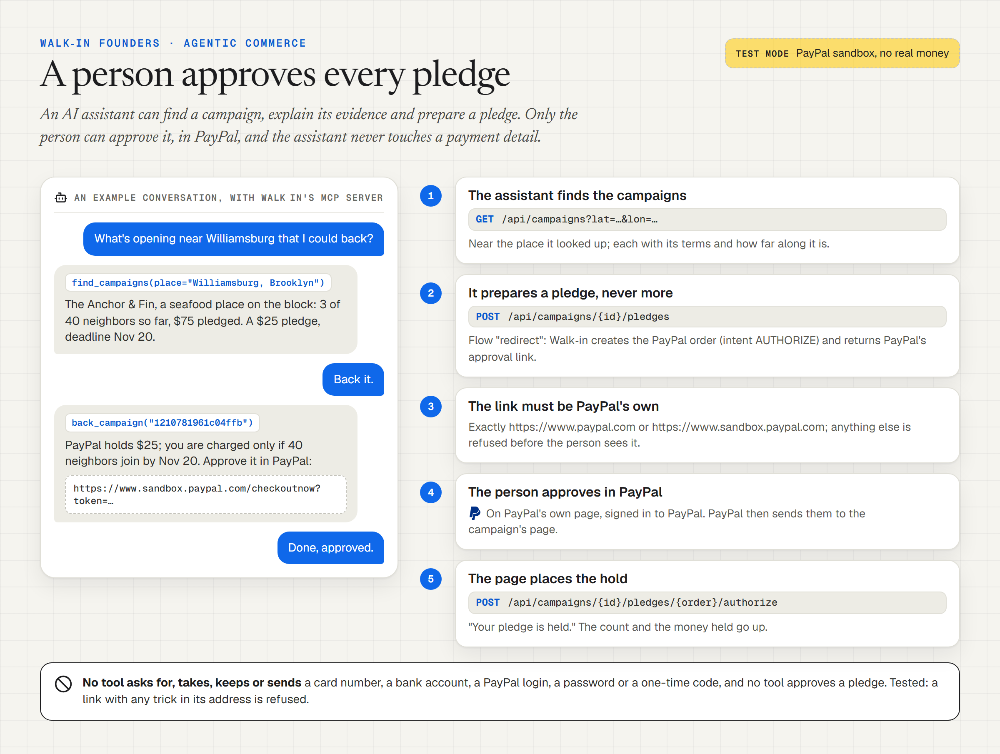

# Walk-in Founders for AI assistants

Walk-in surveys an empty storefront with Qloo taste data and designs the business its block is missing. **Walk-in
Founders** lets the neighbors back that business before the lease is signed: each one pledges a fixed amount with
PayPal, PayPal only holds it, and everyone is charged only if enough people join by the deadline. If the goal is
missed, every hold is released and nobody pays.

An AI assistant is a natural way in. People don't browse for campaigns; they ask "is anyone opening something near
me?" This page shows how an assistant uses Walk-in Founders from that question to a pledge, why that is agentic
commerce done safely, and how to connect Walk-in's MCP server to an assistant. The endpoints are in
[CONTRACT.md](CONTRACT.md), the tools in [mcp_server/README.md](../../mcp_server/README.md), and a summary for
crawling agents in [llms.txt](../../frontend/public/llms.txt), served at https://walkin-app.pages.dev/llms.txt.

## End to end

1. **Find.** The person asks what is opening near them. The assistant calls `find_campaigns` with their place, or with
   `lat` and `lon`: Walk-in's address search places it (`GET /api/geocode`), then `GET /api/campaigns?lat=&lon=&km=`
   lists the open campaigns, nearest first. Without a place, it lists the newest anywhere. Each comes with the business,
   its place and distance, the pledge, supporters against the goal, the deadline and its link.
2. **Explain.** The assistant calls `get_campaign` (`GET /api/campaigns/{id}`) and tells the person what the business
   is, why it belongs on that block (the survey's lines of evidence, from Qloo's taste data), the owner's pitch and
   perks, the progress and the terms, written from the campaign's own numbers: "PayPal holds $25. You are charged only
   if 40 neighbors join by Nov 30; otherwise the hold is released."
3. **Prepare.** When the person says "back it for me", the assistant calls `back_campaign`. The tool reads the campaign
   again and, if it still takes pledges, calls `POST /api/campaigns/{id}/pledges` with `{"flow": "redirect"}`. Walk-in
   creates a PayPal order with intent `AUTHORIZE` for the campaign's amount, with return and cancel URLs, and hands back
   PayPal's approval link. The tool returns that link, the terms, the progress, the deadline and, on the sandbox, "Test
   mode: PayPal sandbox, no real money."
4. **Approve.** The person opens the link and approves the pledge in PayPal, in their own account. The assistant is not
   part of this step.
5. **Hold.** PayPal sends the person back to the campaign's page, `/p/{id}?pledge={pledgeId}`. The page authorizes the
   order: PayPal now holds the money, and the pledge counts toward the goal. The page thanks them, shows the progress
   and how to withdraw while the campaign is open.
6. **Settle.** At the deadline (or earlier, by the owner, once the goal is met), Walk-in settles. Funded: it captures
   every hold, and PayPal Payouts sends the owner the net total. Not funded, or cancelled: it voids every hold, and
   nobody pays.

<picture>
  <source media="(prefers-color-scheme: dark)" srcset="diagrams/agent-pledge-dark.png">
  
</picture>

<details>
<summary>The same, as text</summary>

```mermaid
sequenceDiagram
    actor Person
    participant Assistant
    participant MCP as Walk-in MCP server
    participant Walkin as Walk-in API
    participant PayPal
    Person->>Assistant: Is anyone opening something on my block?
    Assistant->>MCP: find_campaigns(place)
    MCP->>Walkin: GET /api/geocode, then GET /api/campaigns?lat&lon&km
    Walkin-->>MCP: open campaigns, nearest first
    MCP-->>Assistant: business, distance, pledge, progress, deadline, links
    Person->>Assistant: Back it for me
    Assistant->>MCP: back_campaign(id)
    MCP->>Walkin: GET /api/campaigns/{id}, then POST /api/campaigns/{id}/pledges {"flow": "redirect"}
    Walkin->>PayPal: create order (intent AUTHORIZE, return and cancel URLs)
    PayPal-->>Walkin: order id, approval link
    Walkin-->>MCP: {order_id, approve_url}
    MCP-->>Assistant: PayPal's link, the terms, test mode
    Assistant-->>Person: Open this link and approve in PayPal
    Person->>PayPal: approves, in their own account
    PayPal-->>Person: back to /p/{id}?pledge={pledgeId}
    Person->>Walkin: the page authorizes the order: PayPal holds the pledge
    Note over Walkin,PayPal: At the deadline: goal met, capture every hold; missed, void every hold
```

</details>

## Why this is agentic commerce done safely

The agent finds and prepares; PayPal and the person decide.

The agent does the part that takes time and judgment. It finds campaigns near the person, matches them to what they
asked for, explains the evidence and the terms, and prepares the payment. The decisions stay with the parties who own
them. The person approves the pledge in PayPal. PayPal holds the money. The campaign's goal decides whether anyone is
charged at all.

What the design guarantees:

- **The agent never touches payment credentials.** No tool has a field for a card, a bank account, a PayPal login or an
  email, and no Walk-in endpoint an agent calls takes one. The only body the tools send is `{"flow": "redirect"}`. The
  tests check all of this, including that payer details are not passed on when a server sends them.
- **Only PayPal's own page can approve.** `back_campaign` passes on an approval link only when it is `https` on
  `paypal.com` or its sandbox. Without the person's approval there, nothing is held and nothing is charged.
- **A hold, not a charge, and all or nothing.** A pledge is a PayPal authorization. It is captured only if the
  campaign reaches its goal by the deadline; otherwise it is voided. A supporter can withdraw while the campaign is
  open.
- **One pledge per person, only when asked.** The tool's description and the server's instructions tell the model to
  call `back_campaign` only when the person asks to back that campaign, and once per person. Each call creates one
  order, and an order nobody approves holds nothing. Walk-in limits pledges per address.
- **Honest tool annotations.** `find_campaigns` and `get_campaign` are read-only and idempotent. `back_campaign` is
  marked as not read-only and not idempotent, so a client that confirms side effects asks the person before calling it.
- **Numbers from the terms, never from a model.** The terms sentence, the progress and the deadline come from the
  campaign's own numbers, in the same words as its page. The owner's title, pitch and perks were checked by Walk-in's
  rules when the campaign was published: no amounts but the owner's, no counts the evidence does not give.
- **The agent has no account.** It cannot see who pledged, the owner's view, the settlement or the payout. It cannot
  change a campaign's terms, capture, void or withdraw anything.
- **Test mode, said plainly.** This edition runs on PayPal's sandbox. Every answer that shows money says "Test mode:
  PayPal sandbox, no real money."

## Connect the MCP server to an assistant

The server is one Python file, [`mcp_server/walkin_mcp.py`](../../mcp_server/walkin_mcp.py). It speaks MCP over stdio,
so the assistant launches it as a child process. It calls only Walk-in's public API, so it needs no keys.

1. Install Python 3.10 or newer, then the server's requirements:

   ```powershell
   pip install -r mcp_server/requirements.txt
   ```

2. Point the assistant at it, with `WALKIN_URL` set to the Walk-in site. The default is https://walkin-app.pages.dev;
   a local server works too (`http://127.0.0.1:8770` under uvicorn).

   Claude Desktop, in `claude_desktop_config.json` (on Windows `%APPDATA%\Claude\`, on macOS
   `~/Library/Application Support/Claude/`), then restart it:

   ```json
   {
     "mcpServers": {
       "walkin": {
         "command": "python",
         "args": ["C:\\path\\to\\walk-in\\mcp_server\\walkin_mcp.py"],
         "env": { "WALKIN_URL": "https://walkin-app.pages.dev", "WALKIN_WAIT_SECONDS": "50" }
       }
     }
   }
   ```

   VS Code (Copilot agent mode), in `.vscode/mcp.json`:

   ```json
   {
     "servers": {
       "walkin": {
         "type": "stdio",
         "command": "python",
         "args": ["${workspaceFolder}/mcp_server/walkin_mcp.py"],
         "env": { "WALKIN_URL": "https://walkin-app.pages.dev" }
       }
     }
   }
   ```

   Any other client that launches stdio servers works the same way: command `python`, with the path to
   `walkin_mcp.py` as its argument.

3. Ask: "Is anyone trying to open something on my block? I live in Williamsburg, Brooklyn." Then "Why there?", then
   "Back it for me." The assistant answers with PayPal's link; open it and approve the pledge in PayPal.

To try the tools by hand, use the MCP Inspector: `npx @modelcontextprotocol/inspector python mcp_server/walkin_mcp.py`.

In test mode, approving takes a PayPal sandbox personal account, not a real one, and no real money moves.

## Without MCP

Any agent that speaks HTTP can do the same with the public JSON API: `GET /api/campaigns`, `GET /api/campaigns/{id}`
and `POST /api/campaigns/{id}/pledges` with `{"flow": "redirect"}`, then hand the person `approve_url`. The rules are
the same: a person approves every pledge in PayPal, and no agent asks for or handles a payment detail. They are listed
in [llms.txt](../../frontend/public/llms.txt).
