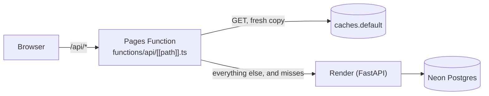

# Walk-in — the front end

React 19 + TypeScript, built by Vite 8 (Rolldown), served by **Cloudflare Pages**. A Pages Function is the app's
**front door** for `/api`: it hands every API request to the backend on Render and keeps the shareable answers at the
edge. Checks: `npm run typecheck` (app, Vite config and the functions), `npm run lint`, `npm test` (Vitest), `npm run build`.

```
npm ci
npm run dev        # Vite on :5173, /api proxied to the local server on :8770 (WALKIN_API to point elsewhere)
npm run build      # typecheck, then dist/
npm run preview    # dist/ on :4173 under the production Content-Security-Policy
```

## Layout

| Where | What |
|---|---|
| `src/main.tsx` | Entry: global styles, starts loading what the opening address needs (`preload.ts`), renders `App` under a crash boundary. |
| `src/App.tsx` | The router: what the address shows (the stage or a page) and every move between screens: links, Back/Forward, the brief's and the survey's own buttons. |
| `src/pages/` | `Stage` (brief + survey sheet beside the map), `SurveyView` (a survey's status, title block and tabs), `PageView` (the other pages, each lazy): `ExamplesPage`, `KitPage`, `DossierPage`, `PlacesPage`, `PrivacyPage`. |
| `src/components/` | Presentational parts: the brief, the survey's sections, the design sheet, tabs, the top bar, the kit's parts (`components/kit/`). |
| `src/state/` | State: the survey reducer and its stream/restore hook (`survey.ts`, `useSurvey.ts`), the brief's form, the survey's tabs, the screen types, and small stores read with `useSyncExternalStore` (`engine`, `session`, `examples`, `theme`). |
| `src/api/` | The API client (`client.ts`), the SSE parser (`stream.ts`), the payload types (`types.ts`), the kit and account APIs, and the answers fetched ahead (`prefetch.ts`). |
| `src/map/` | The survey map: `SurveyMap.tsx` (React shell) over `controller.ts` (Leaflet, Esri tiles), pins, the legend. |
| `src/lib/` | Pure helpers, unit-tested: routes, formatting, the title block, tabs, the kit's words and poster layout, the QR code, lazy loading. |
| `src/chunks.ts`, `src/preload.ts` | The parts that load on demand, and what each address needs before it can show. |
| `src/styles/` | Plain CSS with tokens (`tokens.css`); `index.css` is the global sheet, and the map's, the kit's and the examples' styles load with the code that uses them. |
| `functions/` | The Cloudflare Pages Function for `/api/*` (`api/[[path]].ts`) and its tested logic (`_lib/proxy.ts`, `_lib/cache.ts`). |
| `public/` | `_headers` (CSP and security headers, immutable caching of `/assets/*`), `theme.js` (sets the theme before first paint), the icon. |

## One poster system, different launch scenarios

The launch-kit poster and the Founders campaign poster use the same editor and vector renderer
(`components/kit/PosterSection.tsx` and `PosterArt.tsx`). A regular launch leads with the business's checked offer;
a campaign leads with an actual participation perk, includes every other perk, and states its own payment terms.
The owner may choose a different real perk as the headline. A campaign that has closed cannot print a new-pledge CTA.

`lib/posterProject.ts` selects customer-facing lines from existing checked copy, never invents measured evidence and
does not print targeting names, gap scores or catchment-analysis text as advertising. `lib/posterBrand.ts` chooses a
project-appropriate visual direction and palette; `PosterMotif.tsx` draws original business-related artwork and
subtle contextual shadows. Text and accent-panel contrast are tested at 4.5:1 or better.

New kits and owner-described campaigns use these same adapters; showcase names are not special cases. Automatic
artwork is deterministic, not an unlimited AI image or logo generator. Semantic subjects (pastry, coffee, food,
seafood, fitness, plants, music, craft, books, beauty and retail) are independent of the six palette/style families.
The actual business category outranks incidental keywords or a misleading name. Unknown categories get abstract
art, never an unrelated book. The automatic mark uses initials; owners can supply their own permitted logo.
Clipped sentences, dangling words and mismatched generic copy are rejected; only existing complete source sentences
are reused, and a subline does not repeat the headline.

The owner can change the direction and accent, add a permitted raster logo and choose coming-soon versus now-open
wording. Settings and logos stay on this device; the logo is embedded in downloads, not uploaded. The optional
locator uses real streets around the proposed door, not a decorative survey catchment or competitor arrows.

The branded QR frame sits outside a five-module white quiet zone; modules remain sharp black on white, without an
overlaid logo. Its destination is a public campaign or an approved owner page, never a private receipt or individual
PayPal approval. `lib/posterExport.ts` embeds local fonts and the logo in SVG and 2400×3392 PNG output without
broadening the production CSP. The same renderer supplies a one-page A4 or Letter print/PDF.

The kit's Report tab and `/k/<token>/dossier` embed that customized poster, not a separate template or an editor link.
The report PDF keeps its analysis and maps and adds the actual poster as a dedicated A4/Letter page. The shared
device-local design store keeps the editor, report preview and document synchronized, including the owner's logo,
checked headline and selected real participation perk. Printing waits for typefaces, actual campaign terms and
ready artwork; a failed campaign lookup cannot silently become a generic launch poster. The report preview loads
only when its tab is opened. Campaign posters use the compact "Demo payments — no real money." disclosure; the
PayPal SDK, endpoints and runtime environment remain sandbox.

If text, terms or perks do not fit, printing and downloading stop with an explanation instead of dropping words.

## Routes

Routing is the address itself (`lib/routes.ts` parses it; `App.tsx` follows `popstate`); in-app links go through
`components/Link.tsx`, which changes the address in place and fetches what the target needs as it is pointed at.

| Address | Shows |
|---|---|
| `/` | The brief: pick a storefront (search or the map), what you want, how far customers come from. Any unknown path shows it too. |
| `/s/<id>` | A survey: streamed live after a start, or restored from its record. `#concepts`, `#gaps`… opens a tab; `?sheet=<n>` opens concept *n*'s design sheet. |
| `/k/<token>` | A launch kit: poster, ad copy, tracked links, report (`#poster`, `#copy`, `#links`, `#report`). |
| `/k/<token>/dossier` | The kit's report as a printable document. |
| `/examples` | The finished example surveys, with their kits and reports. |
| `/me` | My places: the signed-in owner's saved surveys and kits. |
| `/privacy` | The privacy note. |

The stage (brief, survey, map) is mounted once and kept, hidden, while a page shows, so Back returns to a survey and a
map exactly as they were. A survey started here gets its own `/s/<id>` address once the server names it.

## State and data

- **Survey**: `useSurvey` streams `/api/run` (SSE, `api/stream.ts`) into `surveyReducer`, or restores a recorded run
  in **one** reducer pass (`restore` replays every event, then the view commits once) and polls it while it still runs.
- **Engine naps**: Render's free instance sleeps; `fetchAwake` waits through the front door's `503 {"waking": true}`
  (Retry-After, two minutes at most) and `state/engine.ts` shows the waking note. An answer the edge served from its own
  copy (`x-walkin-cache: hit | stale`) says nothing about the engine, so it does not count as the engine answering.
- **Answers fetched ahead** (`api/prefetch.ts`, `preload.ts`): a survey's record or a kit is fetched as a link to it
  is hovered, focused or touched, as the page opens on it, and once the examples sit idle on screen (the first screen's
  three, and every example on `/examples`). Each path is asked **once**: the view that opens it takes the same promise.
  Only what no longer changes is kept (a finished survey, a ready kit), for 60 s and 16 answers at most; anything else
  serves the waiting view and goes. A prefetch is a single GET that never waits through a nap; a 4xx it got is final.
  Nothing is fetched ahead on Save-Data or 2G.

## Loading: code splitting

`chunks.ts` names the parts that load on demand; `lib/lazy.ts` wraps them (`lazyModule`, `lazyComponent`). Each part has
a fallback that holds its place, so nothing moves when it arrives:

| Chunk | Loads | Fallback while it loads |
|---|---|---|
| `SurveyMap` (Leaflet + the map, its pins' CSS) | with the first screen, right after the app | the map's empty frame, same box (`pages/Stage.tsx`) |
| `SurveyView` | when the brief is idle, or with a survey's link | "Opening survey …" (`aria-busy`) |
| `DesignContent` | when a survey is on screen and idle | the sheet's drafting state with the concept's name, focus on it |
| `kitPages` (kit + report, `qrcode-generator`, `kit.css`, `sitemap.css`) | with `/k/…` | the page's empty sheet, "Loading the page…" for screen readers |
| `ExamplesPage`, `PlacesPage`, `PrivacyPage` | with their page | the same |

`main.tsx` starts the opening address's chunks and its answer before the first render, so `/s/<id>` loads the survey's
view, the map and the record side by side, and `/k/<token>` the kit's page and the kit. A chunk that fails to load
reloads the page once a minute at most (a newer deploy replaced it); after that the part says it could not load, in
its place, and the rest of the app keeps working.

## The map

`map/controller.ts` draws a Leaflet map on Esri's tiles (`server.arcgisonline.com`, preconnected in `index.html`), the
traced walk or drive (Valhalla, from the API), the site and the open category's pins (`pinLayer.ts`, keyboard-reachable,
labeled). It grows full screen from the brief and from its dock beside a survey; reduced motion turns its animations off.

Street View is a small bottom-right button, opening Google Maps externally without an API key; it does not embed
Google imagery or promise coverage. Measured panel clearance keeps it above attribution, the legend and open cards
instead of covering the site controls. The map uses only the 2D renderer, without a 3D dependency, worker or mode switcher.

Mouse hover on a pin opens a compact preview after 160 ms; a short dismissal delay lets the pointer enter the card.
Clicking, tapping or pressing Enter/Space saves the selection and opens the full card. Hovering another pin temporarily
previews it; leaving the pin and card returns to the saved selection, or closes the preview when nothing was selected.
Clicking another pin or choosing **View details** replaces the saved selection. Keyboard/list highlighting is separate
from hover, and no external page opens automatically.

Concept cards have a direct **Free launch kit** action, reusing the existing idempotent kit endpoint without first
opening a design sheet. Gap scores are labelled `/100`, never a success probability. The displayed favorite-place
percentage is calculated only from valid actual counts and identifies its sample and denominator, not residents.

## The launch kit

`pages/KitPage.tsx` follows a kit while it is built (polling), then shows its parts as tabs; `DossierPage.tsx` is the
report as a document (print rules in `kit.css`, page header/footer from `lib/kit.ts`). The poster's QR code
(`lib/qr.ts`, `qrcode-generator`) and the report's street map (`components/kit/SiteMap.tsx`) load only with the kit.

## The front door and its edge cache



`functions/_lib/proxy.ts` (`frontDoor`) adds the proxy headers (`x-client-ip`, `x-proxy-secret`, `x-forwarded-host`;
visitors' own copies are dropped), keeps redirects on the front door's origin, and answers `503 {"waking": true}` while
Render shows its own wake-up page or gateway errors. `functions/_lib/cache.ts` decides what the edge may keep: only a
`GET` (never the `/api/run` stream) whose answer is `200`, `Cache-Control: public` with `s-maxage > 0`, no `Set-Cookie`
and no `Vary: *`, keyed by the URL alone. The backend decides what is shareable (`app/cache_policy.py`: at the edge,
finished example surveys and their kits for a day, other finished surveys and ready kits for ten minutes, presets and
config for an hour, the examples list for five minutes); the front door only honors it. A stale copy is kept only when
the answer carries `stale-if-error` (RFC 5861), which the backend sends with what belongs to no visitor (presets,
config, the examples list, the examples' surveys and kits), for that long and a week at most. Anyone's own survey or kit
gets no stale copy, so deleting an account stops its share links working within about ten minutes, as the privacy page
says.

Every `/api` answer carries `x-walkin-cache`:

| Value | Meaning |
|---|---|
| `hit` | Served from the edge's fresh copy; the backend was not asked. |
| `miss` | The backend answered and the answer is now kept: a fresh copy for its `s-maxage`, and a stale copy only when it allows one with `stale-if-error` (written after the response, `waitUntil`). |
| `stale` | The backend was waking, down, erroring or slower than 5 s, and a stale copy answered (with `no-store` for the browser). |
| `bypass` | Not kept: other methods, the survey stream, private or uncacheable answers, errors, the waking note. |

Tested with a fake `fetch`, cache and timer: `functions/_lib/cache.test.ts`, `functions/_lib/proxy.test.ts`.

## Security

`public/_headers` (production) and `vite.config.ts` (preview) send the same Content-Security-Policy: scripts and styles
from the app's origin and Google's sign-in only, fonts self-hosted, images over https, no inline script (the theme is
set by `public/theme.js`), `frame-ancestors 'none'`. Qloo's pictures load without a referrer; only https and raster
`data:` images are shown.

## Performance budget

| Budget | Limit | Now |
|---|---|---|
| Initial JS (the entry and what it modulepreloads), raw | ≤ 400 KB | 323 KB (was 673 KB) |
| Initial CSS, raw | ≤ 130 KB | 127 KB (was 162 KB) |
| Layout shift added by lazy loading | none | none (fallbacks hold each part's box; screenshots pixel-identical to the previous build) |
| Requests for a survey's record or a kit per view | 1 | 1, or 0 when fetched ahead |
| Thumbnails (36–44 px) | Qloo's 200-px variant | `-200x-auto.jpg` (a third of the 420-px bytes), the original as fallback |
| Fonts | self-hosted, `font-display: swap`, not preloaded | preloading them was measured slower on a phone (see below) |

## Before and after (Oct 28)

The previous build and this one, served by the same local preview with the same API answers (read from the live site),
so only the front end differs; medians of 3 cold loads. Phone: 4× CPU slowdown, 1.6 Mbps, 150 ms round trips. Desktop:
1440×900, no throttling. On the live site each first load also waits about 0.6 s for its HTML.

| Page | Metric | Phone before | Phone after | Desktop before | Desktop after |
|---|---|---:|---:|---:|---:|
| Home | first paint (FCP) | 2,728 ms | 1,856 ms | 748 ms | 412 ms |
| | largest paint (LCP) | 3,976 ms | 3,060 ms | 1,416 ms | 964 ms |
| | content on screen | 2,175 ms | 1,377 ms | 417 ms | 233 ms |
| Examples | FCP | 2,688 ms | 1,504 ms | 596 ms | 224 ms |
| | LCP | 3,388 ms | 2,328 ms | 660 ms | 548 ms |
| | content on screen | 3,410 ms | 2,008 ms | 1,013 ms | 612 ms |
| Survey | FCP | 2,592 ms | 1,596 ms | 360 ms | 220 ms |
| | content on screen | 5,965 ms | 4,517 ms | 1,744 ms | 897 ms |
| | its record has arrived ¹ | 4,069 ms | 2,593 ms | 1,246 ms | 637 ms |
| | the site's map tiles have loaded ¹ | 9,197 ms | 6,594 ms | 3,653 ms | 3,084 ms |
| Kit | FCP | 2,528 ms | 1,580 ms | 336 ms | 216 ms |
| | LCP | 4,880 ms | 2,952 ms | 956 ms | 800 ms |
| | content on screen | 4,360 ms | 2,846 ms | 923 ms | 766 ms |
| Every page | JS before the first render, raw | 674 KB | 324 KB | 674 KB | 324 KB |

¹ From 3 more interleaved loads of the same survey, timed from the network log.

- The survey's LCP reads worse (phone 3.7 → 6.5 s, desktop 0.8 → 2.6 s) but is not: in both builds it is a map tile.
  The previous build painted a tile of the map's opening view before the survey's record arrived, then flew to the
  site, so its LCP was that first tile; this one has the record before that tile paints, so its first tile is already
  the site's. What a visitor waits for, the site's tiles, comes 2.6 s sooner on a phone and 0.6 s sooner on a desktop.
- Layout shift is unchanged on every page. The phone survey's 0.75 is its sheet rising as the survey docks the map, as
  before.
- Main-thread blocking on a phone is lower on the home page (913 → 579 ms) and the kit (1,648 → 560 ms), about the same
  on the survey, and higher on the examples page (193 → 423 ms), which now also fetches every example's code and
  answers once it is idle.
- Resource hints, A/B on the phone (4 interleaved loads, only `index.html` different): preconnecting to Esri's tile
  hosts brings the home page's LCP forward by about 290 ms (3,434 → 3,148 ms). Preloading the two fonts made every
  phone page slower (home LCP 3,148 → 3,892 ms), as their 160 KB competes with the app's code, so they load on demand.
